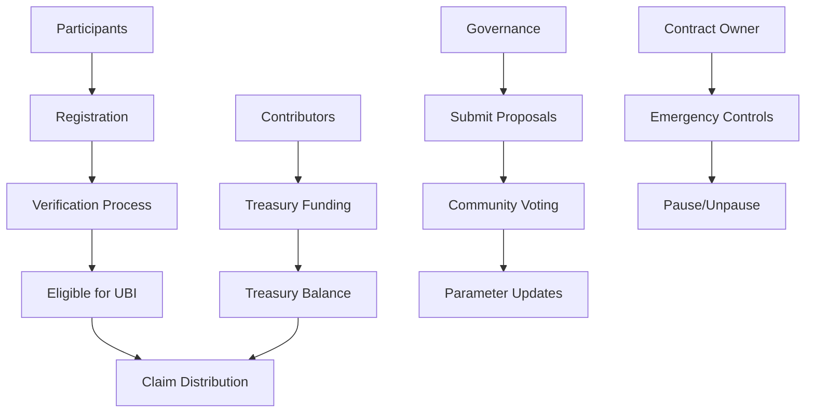

# BitStack UBI - Decentralized Universal Basic Income Protocol

[](LICENSE)
[](https://stacks.co)
[](https://clarity-lang.org)

## Overview

BitStack UBI is a decentralized Universal Basic Income protocol built on the Stacks blockchain, leveraging Bitcoin's security to provide sustainable and transparent UBI distribution. The protocol enables participants to register, undergo verification, and receive periodic STX distributions from a community-managed treasury through democratic governance.

**Now upgraded to Clarity 4** with enhanced security features, improved asset management, and comprehensive event logging.

### Key Features

- **Bitcoin-Secured**: Built on Stacks Layer 2 for Bitcoin security
- **Clarity 4 Compliant**: Uses latest security enhancements and asset allowances
- **Democratic Governance**: Community-driven parameter adjustments with execution
- **Transparent Operations**: All distributions and activities are on-chain with event logging
- **Emergency Controls**: Pause/unpause functionality with emergency withdrawal
- **Comprehensive Tracking**: Complete audit trail of participant activity
- **Real-time Balance**: Direct STX balance tracking prevents sync issues
- **Flexible Participation**: Users can unregister when needed

## System Overview



## Contract Architecture

### Core Components

#### 1. **Participant Management**

- Registration system for new users
- Verification process (admin-controlled)
- Eligibility checking for UBI claims
- Comprehensive tracking of participant activity

#### 2. **Treasury System**

- Community-funded treasury
- Real-time balance tracking via `stx-get-balance`
- Automatic distribution calculations
- Balance management and validation
- Contribution tracking with event logging

#### 3. **Governance Framework**

- Proposal submission system
- Democratic voting mechanism with quorum (10 votes minimum)
- Approval threshold enforcement (60% required)
- Proposal execution after voting period
- Parameter adjustment capabilities
- Voting period management

#### 4. **Emergency Controls**

- Contract pause/unpause functionality
- Owner-only administrative functions
- Emergency withdrawal capability (only when paused)
- Emergency intervention capabilities

#### 5. **Event System**

- Complete event logging for all operations
- Frontend integration ready
- Audit trail for compliance
- Events emitted: registration, verification, claims, contributions, proposals, votes, execution, withdrawals

### Data Structures

```clarity
;; Participant Information
{
  registered: bool,
  last-claim-height: uint,
  total-claimed: uint,
  verification-status: bool,
  join-height: uint,
  claims-count: uint
}

;; Governance Proposals
{
  proposer: principal,
  proposal-type: (string-ascii 32),
  proposed-value: uint,
  votes-for: uint,
  votes-against: uint,
  status: (string-ascii 10),
  expiry-height: uint
}
```

## Data Flow

### 1. Participant Onboarding Flow

```
Registration → Verification → Eligibility Check → UBI Claims
```

### 2. Treasury Management Flow

```
Contributions → Treasury Balance → Distribution Calculation → Payment
```

### 3. Governance Flow

```
Proposal Submission → Voting Period → Vote Counting → Quorum Check → Approval Check → Execution → Parameter Update
```

### 4. Event Emission Flow

```
Contract Action → Event Emission → Frontend Listener → UI Update / Analytics
```

## Getting Started

### Prerequisites

- [Clarinet](https://github.com/hirosystems/clarinet) - Stacks development environment
- [Node.js](https://nodejs.org/) - For testing framework
- [Git](https://git-scm.com/) - Version control

### Installation

1. **Clone the repository**

   ```bash
   git clone https://github.com/carlton-source/bitstack.git
   cd bitstack
   ```

2. **Install dependencies**

   ```bash
   npm install
   ```

3. **Check contract syntax**

   ```bash
   clarinet check
   ```

4. **Run tests**

   ```bash
   npm test
   ```

### Project Structure

```
bitstack/
├── contracts/
│   └── bitstack.clar          # Main UBI contract
├── settings/
│   ├── Devnet.toml           # Development network settings
│   ├── Testnet.toml          # Testnet configuration
│   └── Mainnet.toml          # Mainnet configuration
├── tests/
│   └── bitstack.test.ts      # Contract test suite
├── Clarinet.toml             # Clarinet configuration
├── package.json              # Node.js dependencies
└── README.md                 # This file
```

## Usage

### For Participants

#### 1. Register for UBI

```clarity
(contract-call? .bitstack register)
```

#### 2. Check Eligibility

```clarity
(contract-call? .bitstack can-claim-ubi tx-sender)
```

#### 3. Claim UBI Distribution

```clarity
(contract-call? .bitstack claim-ubi)
```

#### 4. Unregister (Optional)

```clarity
(contract-call? .bitstack unregister)
```

### For Contributors

#### Fund the Treasury

```clarity
(contract-call? .bitstack contribute u1000000) ;; Contribute 1 STX
```

### For Governance Participants

#### 1. Submit a Proposal

```clarity
(contract-call? .bitstack submit-proposal "distribution-amount" u2000000)
```

#### 2. Vote on Proposals

```clarity
(contract-call? .bitstack vote u1 true) ;; Vote 'yes' on proposal #1
```

#### 3. Execute Approved Proposals (Owner Only)

```clarity
(contract-call? .bitstack execute-proposal u1)
```

### For Contract Owner

#### Emergency Withdrawal (When Paused)

```clarity
(contract-call? .bitstack emergency-withdraw u5000000 'SP2J6ZY48GV1EZ5V2V5RB9MP66SW86PYKKQ9H6DPR)
```

## Configuration Parameters

| Parameter | Value | Description |
|-----------|-------|-------------|
| `DISTRIBUTION-INTERVAL` | 144 blocks | ~1 day between claims |
| `MINIMUM-BALANCE` | 10 STX | Minimum treasury balance |
| `DISTRIBUTION-AMOUNT` | 1 STX | Default UBI amount (governable) |
| `PROPOSAL-VOTING-PERIOD` | 1440 blocks | ~10 days voting period |
| `MAX-PROPOSED-VALUE` | 1,000,000 STX | Maximum governance proposal value |
| `PROPOSAL-APPROVAL-THRESHOLD` | 60% | Required approval percentage |
| `PROPOSAL-QUORUM-THRESHOLD` | 10 votes | Minimum votes for execution |

## API Reference

### Public Functions

| Function | Parameters | Returns | Description |
|----------|------------|---------|-------------|
| `register()` | None | `(response bool uint)` | Register as UBI participant |
| `unregister()` | None | `(response bool uint)` | Unregister from UBI (if eligible) |
| `verify-participant(user)` | `principal` | `(response bool uint)` | Verify participant (admin only) |
| `claim-ubi()` | None | `(response uint uint)` | Claim UBI distribution |
| `contribute(amount)` | `uint` | `(response uint uint)` | Contribute to treasury |
| `submit-proposal(type, value)` | `string-ascii`, `uint` | `(response uint uint)` | Submit governance proposal |
| `vote(proposal-id, vote-for)` | `uint`, `bool` | `(response bool uint)` | Vote on proposal |
| `execute-proposal(id)` | `uint` | `(response bool uint)` | Execute approved proposal (owner only) |
| `pause()` | None | `(response bool uint)` | Pause contract (owner only) |
| `unpause()` | None | `(response bool uint)` | Resume contract (owner only) |
| `emergency-withdraw(amount, recipient)` | `uint`, `principal` | `(response uint uint)` | Emergency withdrawal when paused (owner only) |

### Read-Only Functions

| Function | Parameters | Returns | Description |
|----------|------------|---------|-------------|
| `get-participant-info(user)` | `principal` | `(optional {})` | Get participant details |
| `get-treasury-balance()` | None | `uint` | Get current treasury balance |
| `get-proposal(id)` | `uint` | `(optional {})` | Get proposal details |
| `get-distribution-info()` | None | `{}` | Get distribution configuration |
| `can-claim-ubi(user)` | `principal` | `bool` | Check claim eligibility |
| `get-contract-status()` | None | `{}` | Get contract status |

## Security Considerations

### Access Controls

- **Contract Owner**: Emergency pause/unpause, participant verification, proposal execution, emergency withdrawal
- **Registered Users**: UBI claims, governance participation, unregister
- **Anyone**: Registration, treasury contributions

### Safety Mechanisms

- Cooldown periods between claims (144 blocks)
- Real-time balance validation via `stx-get-balance`
- Double-voting prevention
- Proposal expiry enforcement
- Emergency pause functionality
- Emergency withdrawal only when paused
- Quorum and approval thresholds for governance

### Clarity 4 Security Enhancements

- **Asset Allowances**: Explicit `with-stx` allowances prevent unauthorized transfers
- **Response Wrapping**: `as-contract?` returns responses for better error handling
- **Current Contract Keyword**: Direct access to contract principal via `current-contract`
- **Event Logging**: Complete audit trail of all operations

### Governance Security

- Time-locked voting periods (1440 blocks)
- Verified participant requirements
- Value limits on proposals (max 1M STX)
- Transparent voting records
- 60% approval threshold
- 10 vote minimum quorum
- Owner-only execution after voting period

## Testing

Run the comprehensive test suite:

```bash
# Run all tests
npm test

# Check contract syntax
clarinet check

# Run specific test file
npx vitest tests/bitstack.test.ts
```

## Contributing

1. Fork the repository
2. Create a feature branch (`git checkout -b feature/amazing-feature`)
3. Commit your changes (`git commit -m 'Add amazing feature'`)
4. Push to the branch (`git push origin feature/amazing-feature`)
5. Open a Pull Request

### Development Guidelines

- Follow Clarity best practices
- Add comprehensive tests for new features
- Update documentation for API changes
- Ensure all tests pass before submitting PR

## Recent Updates (v2.0)

- ✅ **Clarity 4 Upgrade**: Full compatibility with latest Clarity version
- ✅ **Real-time Balance Tracking**: Direct STX balance queries
- ✅ **Proposal Execution**: Governance can now actually update parameters
- ✅ **Event System**: Complete event logging for frontend integration
- ✅ **Emergency Controls**: Enhanced with withdrawal capability
- ✅ **Voting Thresholds**: Quorum and approval requirements
- ✅ **Unregister Feature**: Users can now exit the system
- ✅ **Improved Security**: Asset allowances and better error handling

## Roadmap

- [x] **Phase 1**: Core UBI functionality (✅ Complete)
- [x] **Phase 2**: Enhanced governance features (✅ Complete)
- [ ] **Phase 3**: Multi-sig verification system
- [ ] **Phase 4**: Multi-token support (SIP-010)
- [ ] **Phase 5**: Cross-chain integration
- [ ] **Phase 6**: Mobile application interface
- [ ] **Phase 7**: Automated verification system

## License

This project is licensed under the MIT License - see the [LICENSE](LICENSE) file for details.

## Support

- **Documentation**: [Stacks Documentation](https://docs.stacks.co)
- **Community**: [Stacks Discord](https://discord.gg/stacks)
- **Issues**: [GitHub Issues](https://github.com/carlton-source/bitstack/issues)

## Event Types

The contract emits the following events for frontend integration:

| Event | Data | Description |
|-------|------|-------------|
| `register` | `user`, `block-height` | New participant registered |
| `unregister` | `user`, `total-claimed`, `block-height` | Participant unregistered |
| `verify` | `user`, `verifier`, `block-height` | Participant verified |
| `claim` | `user`, `amount`, `block-height` | UBI claimed |
| `contribute` | `contributor`, `amount`, `block-height` | Treasury contribution |
| `proposal-created` | `proposal-id`, `proposer`, `proposal-type`, `proposed-value` | New proposal submitted |
| `vote` | `proposal-id`, `voter`, `vote-for` | Vote cast |
| `proposal-executed` | `proposal-id`, `proposal-type`, `new-value` | Proposal executed |
| `emergency-withdraw` | `amount`, `recipient`, `block-height` | Emergency withdrawal |

## Acknowledgments

- Built on [Stacks](https://stacks.co) blockchain with Clarity 4
- Inspired by Universal Basic Income research
- Community-driven development approach
- Bitcoin security and finality
- Enhanced with latest Clarity security features
